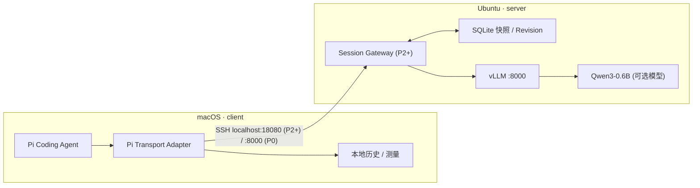

# Pi ↔ vLLM Transport Lab

> **状态：实验性运行时 v0.1（2026-11-18）**。仓库含 Gateway、Pi 扩展原型和自动化测试。模拟 vLLM 的 CI 可执行；**尚未在实际 Mac + Ubuntu + Qwen3 GPU 上验证，不可视为生产就绪**。

在同一个局域网中，以 **macOS 上的 Pi Coding Agent 为客户端**，以 **Ubuntu 上的 vLLM（默认实验模型 Qwen3-0.6B）为推理服务**，研究如何**减少网络重复上传的上下文字节数**，同时保持模型收到的完整请求语义不变。

## 要解决的问题

普通无状态 Chat Completions 每次都由 Agent 发送本轮所需的完整消息历史；vLLM 的 Automatic Prefix Caching 能减少 GPU 的重复 Prefill，**不能自动减少 Mac → Ubuntu 的 HTTP 请求体**。

方案拆成三个可独立测试的层次：

1. **P0：原生链路**：Pi → SSH Tunnel → Ubuntu vLLM，建立正确性基线；
2. **P1：统计/压缩**：测量 payload bytes、网络字节、TTFT；试验 full/gzip；
3. **P2–P4：增量同步**：Pi Provider 发送快照或差分，Ubuntu Gateway 用 SQLite 维护版本并重建原始模型请求，最后做故障恢复和 A/B 验证。

## 文档导航

| 文档 | 目的 |
|---|---|
| [设计目标与术语](docs/00-scope.md) | 网络字节、Token、缓存的边界 |
| [系统架构](docs/01-architecture.md) | Mac/Ubuntu 部署、信任边界、数据流 |
| [Pi 集成](docs/02-pi-integration.md) | 原生模型接入、扩展与 Custom Provider 选择 |
| [Delta v1 协议](docs/03-protocol.md) | 快照/增量、哈希、请求契约和 SSE |
| [会话一致性和恢复](docs/04-state-and-recovery.md) | revision、状态机、幂等与错误恢复 |
| [模型与 vLLM](docs/05-vllm-models.md) | Qwen3-0.6B、工具调用、可替换模型 |
| [部署与运维](docs/06-deployment.md) | SSH 隧道、CUDA/CPU 分支、配置 |
| [基准测试方案](docs/07-benchmark.md) | 4 模式对比、测量定义、工作负载 |
| [测试和验收](docs/08-testing.md) | 正确性、不变量、故障注入 |
| [安全与隐私](docs/09-security.md) | 凭证、网络隔离、会话数据 |
| [实施路线图](docs/10-roadmap.md) | P0–P4、完成定义、里程碑 |
| [决策与待验证问题](docs/11-decisions.md) | ADR、已知风险、取舍 |
| [资料与版本](docs/12-references.md) | 官方文档、复核要求 |
| [协议 JSON Schema](protocol/pi-delta-v1.schema.json) | 客户端/网关共享校验 |
| [模型配置示例](configs/model.yaml) | 模型可替换配置（设计约定） |
| [Pi models.json 示例](configs/models.pi.example.json) | P0 接入参考 |
| [Gateway 配置示例](configs/gateway.example.yaml) | 规划中的服务设置 |
| [AGENTS.md](AGENTS.md) | 后续开发的质量门槛 |

## 代码实现（实验性）

- [Ubuntu FastAPI Gateway](server/gateway/pi_delta/app.py)：SQLite 快照、版本锁、Schema、SHA-256、gzip 解码、标准 Chat Completions SSE 转发。
- [Pi delta 扩展](client/pi-delta/index.ts)：使用原生 OpenAI Completions 解析与三个 Provider Hooks；支持 Full（无状态基线）与 Delta；需要目标 Pi 版本实机验证。
- [模型/网络脚本](scripts/) 和 [CUDA Compose](deploy/docker-compose.yml)：SSH loopback，避免暴露模型端口。
- [Python 单元/集成测试](server/gateway/tests/) 和 [CI](.github/workflows/ci.yml)。
- [四模式真实 HTTP-body A/B CLI](server/gateway/pi_delta/benchmark.py)：需要已经运行的模型；不会模拟 GPU 或伪造结果。
- [完整运行步骤](docs/13-quickstart-runtime.md) 与 [验证范围](docs/verification.md)。

## 基本架构

**说明**：P0 阶段 Pi 直接经过 SSH 隧道访问 vLLM；图中的 Gateway 在 P2 才加入。Gateway → vLLM 可保持完整无状态请求，因为它们位于同一台 Ubuntu 主机。目标首先是减少 **Mac → Ubuntu** 的重复上传。

## 验收原则

- **正确性优先**：Gateway 重建出的完整模型请求必须与基线模型请求在明确的规范化规则下相同；无法验证则回退完整快照。
- **不夸大性能**：网络节省、Token 数量、TTFT 和 Prefix Cache 命中独立度量；未实测不写节省百分比。
- **版本锁定**：Pi、vLLM、模型权重/Chat Template/Tokenizer 与解析器都需记录版本，不能依赖 `latest` 得到可复现实验。
- **安全默认**：vLLM 和 Gateway 绑定 loopback，Mac 使用 SSH 隧道；不把内部推理端口直接公开。
- **模型可选**：Qwen3-0.6B 只作协议验证基准，不能假定其工具调用足以完成复杂编程任务。

## 参考

- [Pi 自定义模型](https://docs.pi.dev/latest/models-configuration)
- [Pi Custom Provider](https://docs.pi.dev/latest/custom-provider)
- [Pi Extensions](https://docs.pi.dev/latest/extensions)
- [vLLM OpenAI-compatible serving](https://docs.vllm.ai/en/latest/serving/openai_compatible_server/)
- [vLLM Prefix Caching](https://docs.vllm.ai/en/stable/features/automatic_prefix_caching/)
- [Qwen3-0.6B 模型卡](https://huggingface.co/Qwen/Qwen3-0.6B)

> 协议 v1 已有初版代码和无 GPU CI 验证，仍属实验性实现；工具调用质量、Mac Pi Hook 兼容性、GPU/网络真实性能与容错全覆盖仍待实机验证。
