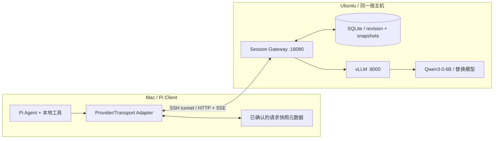
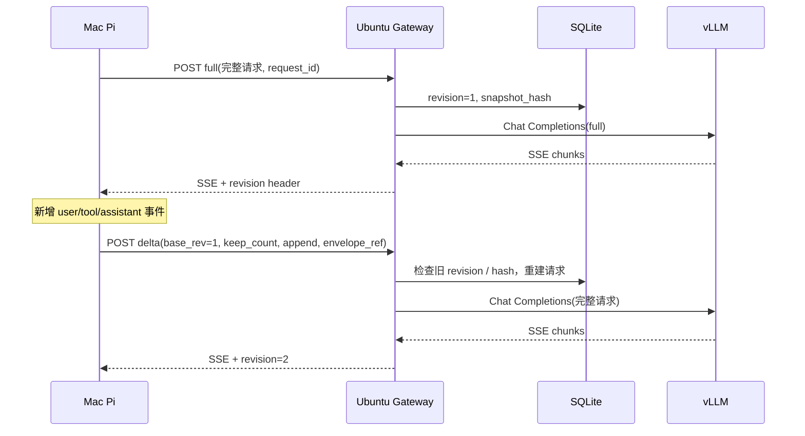

# 01 · 端到端架构与数据流

## 1.1 设计原则
- **先建立真值基线**：Pi 原生 `openai-completions` 的 Provider 请求为 full golden request。
- **只优化跨主机链路**：Ubuntu 内的 Gateway 将完整消息还原后仍用标准 vLLM API；这使模型与协议升级解耦。
- **状态由 Gateway 管理、工具由 Pi 执行**：server 不读取 Mac 本地文件，也不执行 Pi tools。
- **强一致性优于压缩率**：缓存失配、版本断裂或模型变更必须拒绝/全量回退。
- **最小依赖**：单 Ubuntu 使用 SQLite WAL；不引入 Redis/K8s。

## 1.2 组件拓扑

P0 **不启动 Gateway**：Mac:8000 SSH forward 到 Ubuntu:8000。P2 后 Mac:18080 SSH forward 到 Ubuntu:18080，Gateway 再访问 Ubuntu:8000。

## 1.3 请求/响应时序

模型输出是服务端生成并由 Pi 写进自己历史的；Gateway 的快照针对**已接受的推理输入请求**，不假装已经替 Pi 添加最终输出。第二次客户端请求会把此前生成的 assistant 消息作为新的输入变更同步。工具执行结果也来自 Pi 本地。

## 1.4 一次工具调用的职责
1. Pi 根据本地会话形成 `messages/tools`，发送标准 full 或 delta。
2. Gateway 重建标准 OpenAI Chat Completions JSON，校验 hash。
3. vLLM 返回 tool_calls 流片段或完整 tool_calls；Gateway 只做规范转发。
4. Pi 负责组装参数、校验、决定是否执行、执行本地 shell/read/write，再写入 tool 结果。
5. 新的 Pi 推理请求同步这些内容；Gateway 不自行执行工具。

## 1.5 网络拓扑
| 链路 | P0 | P2+ | 暴露范围 |
|---|---|---|---|
| Mac Pi → Mac localhost | `localhost:8000` | `localhost:18080` | Mac 本机 |
| Mac ssh → Ubuntu sshd | 22/TCP (可配置) | 22/TCP | 受控 LAN |
| Ubuntu loopback → Gateway | 无 | 18080 | Ubuntu 本机 |
| Ubuntu loopback → vLLM | 8000 | 8000 | Ubuntu 本机 |

## 1.6 存储与缓存的边界
- Pi 本地的对话持久化是源历史；Gateway 的快照是传输镜像，不是另一个事实源。
- Gateway 保存 *最近一次成功接纳的推理输入* 和必要日志，可配置 TTL/最大字节。会话失效返回 410，让客户端 full sync。
- vLLM 前缀缓存保存的是可复用的计算状态，不等于持久化历史。
- Gateway 可以 gzip 请求和响应；但 SSE 压缩可能影响交互延迟，应单独对照测试。
- 若未来加入多 Gateway 实例，需要共享持久化、锁和请求路由；v1 不涵盖。

## 1.7 正确性隔离
正式 Benchmark 使用固定、可序列化的 Pi Provider payload replay，而非让随机模型分别自主产生不同历史。通过 Replay Harness 分离网络协议的正确性与模型输出随机性；功能验收另做 live-agent 工作流。
