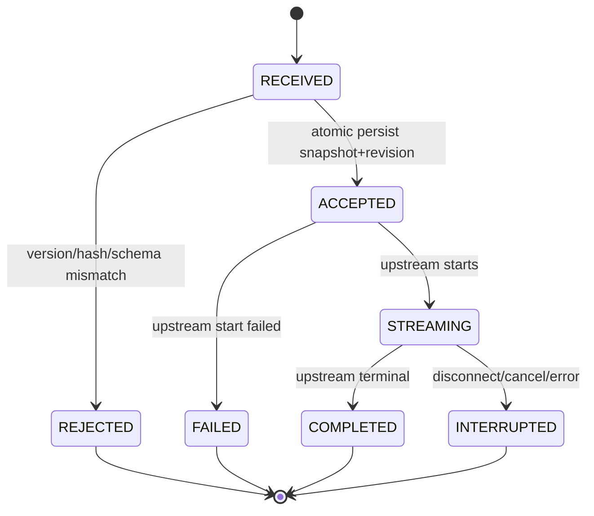

# 04 · 会话状态机、一致性与恢复

## 4.1 核心定义
- **Gateway accepted input**：已经通过 hash 与版本校验、并被持久化的下游推理请求。
- **Model completed**：vLLM 完整结束生成；不等于客户端已接收完毕。
- **Client committed**：Pi 已收到终止流事件并将输出写回会话。
- 每个 `(session_id, branch_id)` 在同一时刻只允许一个更改 revision 的请求。
- 服务端仅保存最后一个**请求输入**快照及有限快照历史；模型生成的 assistant/tool 响应由 Pi 下一轮作为新增输入上传。

### 4.1.1 Full/resync 的代际隔离

首次 full 仅在新的 `(session_id, transport_branch_id)` 上创建 revision=1。已有分支收到一个不同 request_id 的 full 必须返回 `409 BRANCH_ALREADY_EXISTS`。需要重新同步时，Pi 为同一个逻辑分支创建新的随机 transport_branch_id 并上传 full；旧分支只读直到 TTL 清理。这样能防止已在网络中延迟的旧 Delta 写入新历史。

## 4.2 请求状态机


提交点是 `RECEIVED → ACCEPTED`：原子检查 base revision、写入新请求快照、写入 request_id/body_hash、revision+1。任何失败都不能出现只加 revision、未写 snapshot 的中间态。建议 SQLite WAL + BEGIN IMMEDIATE + 单事务。

## 4.3 幂等与重试语义
- request_id 唯一，服务器保存 `request_id → request_payload_hash, target_revision, lifecycle_status`。
- 相同 ID + 不同 body：409，绝不覆写。
- 相同 ID + 同 body 且仍在执行：返回确定的“already running”错误或支持明确的 reconnect token，**不能默认再启动一轮推理**。
- 相同 ID + 同 body 且已完成：若未保存可重放事件流则返回需 full resync 的错误，而不是假装原始响应可重播；P3 如实现 durable SSE replay 才允许回放。
- network timeout 后客户端应先查询请求状态（可增设受鉴权 `GET /delta/v1/requests/{request_id}`），若无法确认则用**新的 request_id + 新 transport_branch_id + full snapshot**恢复，不复用可能误判的增量链。
- request idempotency 只约束 Gateway；Pi 的 shell、写文件、git commit 等工具执行需要它自身的确认机制，禁止承诺端到端 exactly-once。

## 4.4 断线时的歧义
| 断点 | 服务端可能状态 | 保守策略 |
|---|---|---|
| 请求发送前 | 无状态更新 | full/再次发送（新 request id） |
| 接收请求但 ACK 未到 | 可能已存 revision | 查询状态；未知则 full resync |
| SSE 接收一半 | 模型可能已完成 | 不执行不完整 tool call；查询并重新同步 |
| Gateway 重启 | SQLite 状态存在、流丢失 | 已接受的快照可恢复；新 full 对齐 |
| vLLM 重启 | KV cache 丢失 | Gateway 保留逻辑历史，下一轮重建完整请求 |
| Mac 进程退出 | 本地 Pi 历史可能比 server 老/新 | 从 Pi 持久化对话重建 full request |

## 4.5 变更历史
- 普通追加：旧消息完全相同，`keep_count=len(old_messages)`。
- 中间编辑/compact：计算最大公共前缀；以 `replace_suffix` 重建后缀；长度和哈希严格校验。
- 会话分支：分配新的 `branch_id`，第一次使用 full；禁止跨 branch 复用 revision。
- 模型 / chat template / tokenizer / tool parser / reasoning mode 变化：`model_fingerprint` 变化，必须新建兼容快照；P2 默认 full，不复用旧 KV 的预期。
- 重放带工具结果的旧历史：仅重建消息，不应重新执行工具。

## 4.6 存储设计（v1）
```text
sessions(session_id PK, client_id, created_at, expires_at)
branches(session_id, branch_id PK composite, revision, request_hash,
         envelope_hash, model_fingerprint, updated_at)
snapshots(session_id, branch_id, revision, request_json_encrypted_or_protected,
          sha256, created_at)
requests(request_id PK, session_id, branch_id, payload_sha256,
         target_revision, status, started_at, finished_at, error_code)
```

单用户可用 SQLite（权限 0600），数据库行数与快照大小设上限，执行 TTL 清理；敏感代码始终可能保存在快照里，必要时启用应用级加密并妥善保管密钥。

## 4.7 不变量测试
- 同分支序列单调递增，绝不跳版或重用 revision。
- 如果相同 request_id 被重复发送，两次不能产生两个不同 target_revision。
- 任一 accepted revision 必须具有完整可验证的快照。
- 旧 revision 的 Delta 不能污染新 revision。
- 网络异常后客户端只能在确定的已确认版本上计算 Delta，否则 full。
- Gateway 请求重建 hash 不匹配时**不调用 vLLM**。
